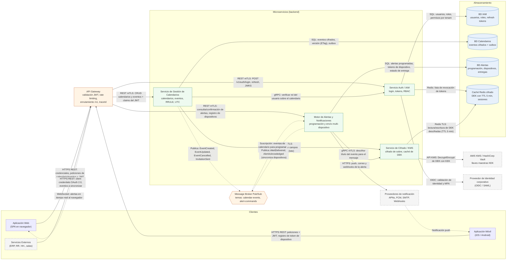
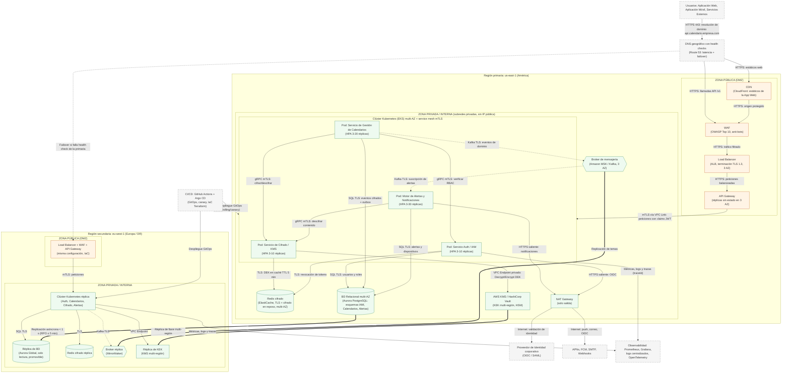

# ISWZ2202 – Diseño y Arquitectura de Software · Semana 9

## Servicio de Calendario Corporativo para una Empresa Multinacional

**Documento 02 – Diagramas de arquitectura (Paso 3)**

| Campo | Valor |
|---|---|
| Estudiante | *(Nombre y Apellido)* |
| Herramienta de modelado | draw.io (importación Mermaid) / IcePanel (modelo C4) |
| Enlace de lectura (sin cuenta) | *(pegar aquí el enlace público de draw.io o IcePanel)* |

---

## 0. Cómo importar los diagramas

### 0.1 En draw.io (diagrams.net)

1. Abrir <https://app.diagrams.net> y crear un diagrama en blanco (guardar en Google Drive, OneDrive o GitHub para obtener un enlace público).
2. Menú **Organizar → Insertar → Avanzado → Mermaid…** (*Arrange → Insert → Advanced → Mermaid…*).
3. Pegar **solo el contenido** del bloque `mermaid` (sin las líneas con las tres comillas invertidas) y pulsar **Insertar**.
4. Ajustar la distribución si es necesario (**Organizar → Distribución → Horizontal**) y exportar como PNG/SVG para el documento de entrega.
5. Para el enlace de lectura: **Archivo → Publicar → Enlace** (o compartir el archivo con permiso "cualquiera con el enlace puede ver").

> Alternativa de verificación rápida: el código también se visualiza en <https://mermaid.live> antes de importarlo. En esta carpeta se incluyen las vistas previas ya renderizadas: `diagrama_componentes_conectores.png` y `diagrama_infraestructura.png`.

### 0.2 Convenciones de los diagramas

| Elemento | Representación |
|---|---|
| Componente en ejecución (servicio, aplicación) | Rectángulo |
| Almacén de datos (BD, caché) | Cilindro |
| Message Broker | Hexágono |
| Sistema externo | Rectángulo con borde discontinuo (clase `ext`) |
| Petición–respuesta síncrona | Flecha continua `-->` |
| Evento asíncrono (publicación/suscripción) | Flecha punteada `-.->` |
| Etiqueta de cada flecha | Protocolo + **qué datos o eventos viajan** |

---

## 1. Diagrama de Componentes y Conectores

### 1.1 Código Mermaid

### 1.2 Catálogo de componentes

| ID | Componente | Responsabilidad | Requisito cubierto |
|---|---|---|---|
| WEB | Aplicación Web | Interfaz de calendario en navegador; muestra fechas convertidas a la zona horaria del usuario. | RQ-01, RQ-05 |
| MOV | Aplicación Móvil | Cliente nativo; recibe notificaciones push; caché local de lectura sin conexión. | RQ-01, RQ-04 |
| EXT | Servicios Externos | Sistemas corporativos que crean o leen eventos por API. | RQ-01 |
| GW | API Gateway | Punto de entrada único: TLS, validación JWT, rate limiting, enrutamiento por versión, `traceId`, WebSocket. | RQ-01, RQ-02 |
| AUTH | Servicio Auth / IAM | Autenticación federada, emisión de JWT y refresh tokens, RBAC y verificación de *tenant*. | RQ-02 |
| CAL | Servicio de Gestión de Calendarios | Calendarios, eventos, recurrencias RRULE, almacenamiento en UTC, concurrencia optimista, outbox. | RQ-05, RQ-03 |
| CRY | Servicio de Cifrado / KMS | Único componente que maneja llaves: cifrado de sobre, caché de DEK, rotación. | RQ-03 |
| ALR | Motor de Alertas y Notificaciones | Programa recordatorios, expande recurrencias, envía a todos los dispositivos de forma idempotente. | RQ-04 |
| BRK | Message Broker Pub/Sub | Desacopla productores y consumidores; partición por `calendarId`; DLQ. | RQ-04 |
| DBIAM / DBCAL / DBALR | Bases de datos por servicio | Persistencia independiente por microservicio (esquemas separados en el clúster relacional). | RQ-02, RQ-03, RQ-04 |
| RED | Caché Redis cifrado | DEK descifradas con TTL corto, revocación de tokens. | RQ-03 (rendimiento) |
| KMS | AWS KMS / HashiCorp Vault | Custodia de llaves maestras con rotación automática. | RQ-03 |
| IDP | Proveedor de Identidad | SSO corporativo y MFA. | RQ-02 |
| PUSH | Proveedores de notificación | APNs, FCM, SMTP y webhooks. | RQ-04 |

### 1.3 Catálogo de conectores

| Origen → Destino | Tipo de conector | Qué viaja |
|---|---|---|
| WEB / MOV / EXT → GW | Petición–respuesta HTTPS (REST) | Credenciales, JWT, peticiones CRUD de calendarios y eventos |
| GW → WEB | WebSocket | Alertas en tiempo real |
| GW → AUTH / CAL / ALR | REST con mTLS | Peticiones enrutadas + *claims* del token + `traceId` |
| AUTH → IDP | OIDC | Validación de identidad y MFA |
| CAL → AUTH | gRPC | Consulta de permisos RBAC sobre un calendario |
| CAL → CRY, ALR → CRY | gRPC con mTLS | Campos a cifrar/descifrar (en lote) |
| CRY → KMS | API del KMS | DEK cifrada ↔ DEK en claro |
| CRY / AUTH → RED | Consulta Redis sobre TLS | DEK en caché; lista de revocación |
| AUTH / CAL / ALR → BD | Consulta SQL | Datos persistentes de cada servicio |
| CAL → BRK | Evento (publicación) | `EventCreated`, `EventUpdated`, `EventCancelled`, `InvitationSent` |
| BRK → ALR | Evento (suscripción) | Eventos de calendario para programar alertas |
| ALR → BRK | Evento (publicación) | `AlertDelivered`, `AlertAcknowledged` |
| ALR → PUSH → MOV | HTTPS / push | Contenido de la alerta para cada dispositivo |

> **Verificación de calidad (guía, Paso 3):** todas las flechas tienen etiqueta con lo que viaja; ningún componente queda sin conectores; cada requisito RQ-01 a RQ-05 tiene al menos un componente responsable.

---

## 2. Diagrama de Infraestructura (despliegue multi-región)

### 2.1 Código Mermaid

### 2.2 Separación de zonas

| Zona | Elementos | Reglas de red |
|---|---|---|
| **Pública (DMZ)** | DNS, CDN, WAF, Load Balancer, API Gateway | Único punto expuesto a Internet (puerto 443). El WAF filtra inyecciones, XSS y bots; el LB termina TLS 1.3. |
| **Privada / Interna** | Clúster Kubernetes (4 microservicios), Redis cifrado, BD relacional multi-AZ, AWS KMS / Vault, Broker, NAT Gateway | Subredes sin IP pública. Solo el API Gateway entra (VPC Link). Grupos de seguridad de mínimo privilegio; mTLS entre pods; KMS accesible solo mediante VPC Endpoint. La única salida a Internet es el NAT Gateway (APNs/FCM/SMTP/IdP). |

### 2.3 Coherencia 1 a 1 entre diagramas

| Componente (diagrama 1) | Nodo de despliegue (diagrama 2) | Zona |
|---|---|---|
| Aplicación Web | Navegador del usuario; estáticos servidos por CDN | Pública |
| Aplicación Móvil | Dispositivo del usuario | Externa |
| Servicios Externos | Sistemas del cliente en Internet | Externa |
| API Gateway (GW) | API Gateway gestionado detrás de WAF + LB (3 AZ) | **Pública** |
| Servicio Auth / IAM (AUTH) | Pod `AUTH1` en EKS | **Privada** |
| Servicio de Gestión de Calendarios (CAL) | Pod `CAL1` en EKS | **Privada** |
| Servicio de Cifrado / KMS (CRY) | Pod `CRY1` en EKS | **Privada** |
| Motor de Alertas y Notificaciones (ALR) | Pod `ALR1` en EKS | **Privada** |
| Message Broker Pub/Sub (BRK) | Amazon MSK / Kafka (3 AZ) | **Privada** |
| BD IAM, BD Calendarios, BD Alertas | Esquemas separados en Aurora PostgreSQL multi-AZ | **Privada** |
| Caché Redis cifrado (RED) | ElastiCache Redis con TLS y cifrado en reposo | **Privada** |
| AWS KMS / HashiCorp Vault (KMS) | KMS con HSM, accesible por VPC Endpoint | **Privada** |
| Proveedor de Identidad (IDP) | Servicio externo (salida vía NAT) | Externa |
| Proveedores de notificación (PUSH) | Servicios externos (salida vía NAT) | Externa |

> Todos los componentes del diagrama de componentes y conectores aparecen desplegados en algún nodo, y cada región replica el mismo conjunto (la región secundaria se representa de forma agrupada para mantener la legibilidad).

---

## 3. Guía para modelar en IcePanel (modelo C4)

IcePanel organiza el modelo en niveles C4. Se recomienda crearlo así:

### 3.1 Nivel 1 – Contexto

| Objeto | Tipo IcePanel | Relaciones (etiqueta) |
|---|---|---|
| Empleado | Actor | → *Servicio de Calendario*: "Gestiona calendarios y recibe alertas" |
| Administrador de TI | Actor | → *Servicio de Calendario*: "Administra usuarios, roles y políticas" |
| Servicios Externos (ERP, RR. HH.) | Sistema externo | → *Servicio de Calendario*: "Sincroniza eventos por API REST" |
| **Servicio de Calendario** | Sistema (en alcance) | → IdP: "Valida identidad (OIDC)"; → Proveedores de notificación: "Envía push/correo" ; → KMS: "Solicita cifrado de llaves" |
| Proveedor de Identidad | Sistema externo | — |
| APNs / FCM / SMTP | Sistema externo | — |
| AWS KMS / Vault | Sistema externo | — |

### 3.2 Nivel 2 – Contenedores (dentro de "Servicio de Calendario")

| Objeto | Tipo IcePanel | Tecnología (etiqueta) |
|---|---|---|
| Aplicación Web | App | React SPA |
| Aplicación Móvil | App | Kotlin / Swift |
| API Gateway | App | AWS API Gateway / Kong |
| Servicio Auth / IAM | App | Java Spring Boot / Keycloak |
| Servicio de Gestión de Calendarios | App | Java Spring Boot |
| Servicio de Cifrado / KMS | App | Go |
| Motor de Alertas y Notificaciones | App | Node.js / Java |
| Message Broker Pub/Sub | Store (tipo *Message broker*) | Apache Kafka (MSK) |
| BD IAM, BD Calendarios, BD Alertas | Store | PostgreSQL (Aurora) |
| Caché Redis cifrado | Store | Redis (ElastiCache) |

**Conexiones:** copiar exactamente las filas del catálogo de conectores (sección 1.3), indicando en IcePanel la *dirección* (*outgoing*), la *tecnología* (HTTPS, gRPC, SQL, Kafka) y la *descripción* (qué viaja). Marcar las conexiones asíncronas con la etiqueta `async`.

### 3.3 Despliegue

Usar **Tags** de IcePanel para representar la infraestructura: `zona-publica`, `zona-privada`, `region-us-east-1`, `region-eu-west-1`, y aplicarlos a cada objeto según la tabla 2.3. Crear un *Flow* "Crear evento con alerta" que recorra: Aplicación Web → API Gateway → Calendarios → Cifrado → BD Calendarios → Broker → Motor de Alertas → APNs/FCM → Aplicación Móvil.

### 3.4 Publicación

**Share → Public link (view only)** para que el enlace abra sin cuenta, tal como exige la guía.
